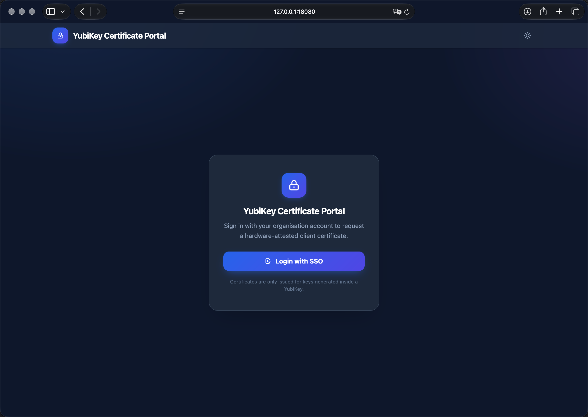
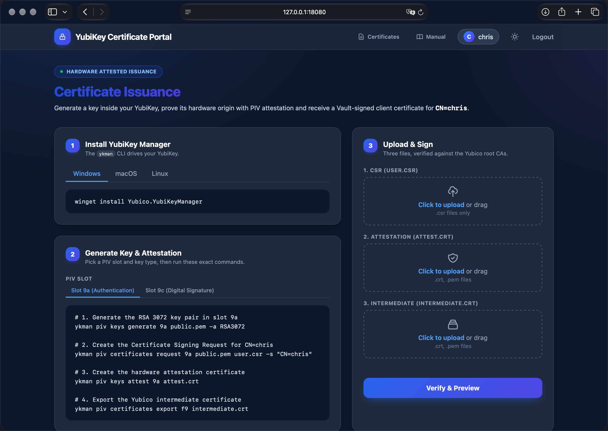
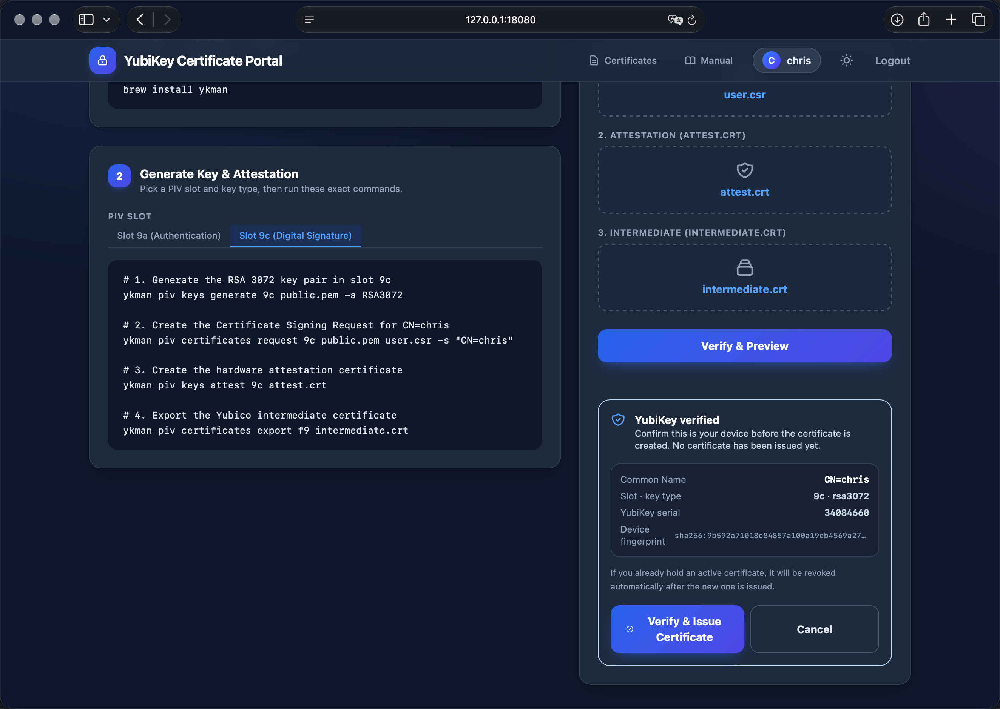

# YubiVault

YubiVault is an airgapped **Validation Middleware & Vault Delegation Proxy** for signing and issueing certificates. It enforces hardware-backed cryptographic origin by verifying that a Certificate Signing Request (CSR) was generated directly inside a physical YubiKey (Slot `9a` or `9c`) using YubiKey PIV Attestation before delegating the signing request to HashiCorp Vault / OpenBao.

---

## Features

- **Hardware Attestation Verification**: Parses Yubico ASN.1 Key Origin OIDs (`1.3.6.1.4.1.41482.3.3...`) to prove keys were generated on-device and never exported or created in software.
- **Flexible PIV Slot Selection**: Supports both Slot `9a` (Authentication) and Slot `9c` (Digital Signature) with dynamically updated client terminal commands.
- **Automatic Cert Revocation**: Optional `revoke_existing` mode that safely identifies and revokes prior active, unexpired certificates matching the user's Common Name before issuing a new certificate.
- **Yubico Root CA Chain Validation**: Validates the YubiKey attestation certificate chain against official Yubico Root CAs.
- **OIDC Authentication & Delegation**: Authenticates users via OIDC (Keycloak, Entra ID, Authelia, Okta) and exchanges the user's raw ID token with Vault JWT auth, maintaining strict Vault entity alias mapping.
- **Customizable Branding**: Configurable application title and short title via `config.yaml`.
- **Audit Trail**: Append-only, hash-chained JSONL audit log of logins, certificate issuance, denials and revocations, including the YubiKey serial, firmware and device fingerprint (never ID tokens or secrets). Tamper-evident, with a `--verify-audit` CLI check.
- **OIDC Group Authorization**: Optionally restrict certificate issuance (and the inventory/manual pages) to users holding an allowed OIDC group.
- **YubiKey Identity Capture & Preview**: The YubiKey serial number, firmware and a stable device fingerprint are extracted from the attestation certificate and shown in a confirmation step before anything is issued.
- **Device Policy & Pinning**: Enforce a minimum YubiKey firmware and serial (fail-closed), and optionally pin each Common Name to one or more known device fingerprints.
- **Session Timeouts**: Absolute maximum session age and an inactivity timeout, both configurable.
- **Live Configuration Reload**: `config.yaml` is re-read every 10 seconds and applied without a restart; a reload is logged only when a change is actually detected.
- **`--check-config` CLI**: Validate the configuration, Yubico roots, Vault/AppRole connectivity and OIDC discovery without starting the service.
- **`--verify-audit` CLI**: Verify the integrity of the audit trail's hash chain.
- **Rich Readiness Probe**: `/readyz` reports Vault reachability, OIDC discovery and (when enabled) AppRole authentication.
- **Systemd Management**: Built-in `--install` and `--uninstall` flags for automated systemd service management and production deployment to `/etc/yubivault` and `/usr/local/bin/yubivault`.
- **Airgapped Design**: Dependencies (HTMX, Tailwind CSS, Favicon, Yubico Root CAs) are served entirely locally without third-party CDNs or runtime internet access.
- **Dark Mode Support**: Automatic OS theme detection with manual light/dark toggle and `localStorage` persistence.

---

## UI Screenshots

<p align="center">
  
</p>

<p align="center">
  
</p>

<p align="center">
  
</p>

---

## Directory Structure

### Development Layout

Ensure your project tree matches the following layout before compiling:

```text
.
├── config.yaml               # Operational configuration
├── go.mod                    # Go module definition
├── go.sum                    # Go module checksums
├── server.go                 # Main application logic
├── input.css                 # Tailwind CSS v4 entrypoint
├── yubico-roots.pem          # Combined official Yubico Root CAs
├── templates/
│   └── index.html            # HTMX + Tailwind UI template
└── static/
    ├── favicon.svg           # Portal favicon
    ├── htmx.min.js           # Airgapped HTMX library
    └── tailwind.css          # Compiled Tailwind CSS output
```

### Production Service Layout (`/etc/yubivault/`)

When installed via `sudo ./yubivault --install`, the binary is copied to `/usr/local/bin/yubivault` and runtime files are staged at `/etc/yubivault/`:

```text
/etc/yubivault/
├── config.yaml
├── yubico-roots.pem
├── templates/
│   └── index.html
└── static/
    ├── favicon.svg
    ├── htmx.min.js
    └── tailwind.css
```

---

## Prerequisites

- **Go**: Version 1.22 or higher
- **YubiKey Manager CLI (`ykman`)**: Installed on client machines
- **HashiCorp Vault / OpenBao**: Configured with PKI secrets engine & JWT/OIDC auth engine
- **OIDC Provider**: Keycloak, Entra ID, Authelia, or Okta

---

## Setup & Installation

### 1. Initialize Go Module & Dependencies

```bash
go mod init yubivault
go mod tidy
```

### 2. Download Airgapped Assets

#### A. HTMX Library & Favicon

```bash
mkdir -p static
curl -L -o static/htmx.min.js https://unpkg.com/htmx.org@4/dist/htmx.min.js
```

Create `static/favicon.svg`:

```xml
<svg xmlns="http://www.w3.org/2000/svg" viewBox="0 0 24 24" fill="none" stroke="#2563eb" stroke-width="2" stroke-linecap="round" stroke-linejoin="round">
  <rect x="3" y="11" width="18" height="11" rx="2" ry="2" fill="#2563eb" fill-opacity="0.15"/>
  <path d="M7 11V7a5 5 0 0 1 10 0v4"/>
  <circle cx="12" cy="16" r="1.5" fill="#2563eb"/>
</svg>
```

#### B. Yubico Root & Intermediate CAs

```bash
curl -sL \
  https://developers.yubico.com/PKI/yubico-piv-ca-1.pem \
  https://developers.yubico.com/PKI/yubico-ca-1.pem \
  https://developers.yubico.com/PKI/yubico-intermediate.pem \
  > yubico-roots.pem
```

---

### 3. Build Airgapped Tailwind CSS (v4)

#### A. Create `input.css`

```bash
cat <<EOF> input.css
@import "tailwindcss";

@custom-variant dark (&:where(.dark, .dark *));
EOF
```

#### B. Download Tailwind CLI & Compile

- **macOS ARM64 (Apple Silicon):**

  ```bash
  curl -sLO https://github.com/tailwindlabs/tailwindcss/releases/latest/download/tailwindcss-macos-arm64
  chmod +x tailwindcss-macos-arm64
  ./tailwindcss-macos-arm64 -i input.css -o ./static/tailwind.css --content="./templates/*.html" --content="./server.go" --minify
  ```

- **Linux x86_64:**

  ```bash
  curl -sLO https://github.com/tailwindlabs/tailwindcss/releases/latest/download/tailwindcss-linux-x64
  chmod +x tailwindcss-linux-x64
  ./tailwindcss-linux-x64 -i input.css -o ./static/tailwind.css --content="./templates/*.html" --content="./server.go" --minify
  ```

---

## Configuration (`config.yaml`)

Create `config.yaml` in the project root or `/etc/yubivault/config.yaml`. A
fully commented reference lives in `config.yaml.example`; omitted options fall
back to the defaults noted below.

The file is reloaded at runtime: it is re-read every 10 seconds and, when its
contents changed, the new configuration is applied live without a restart (a
reload is logged only when a change is detected). The listen address and the
log/audit destinations still require a restart.

```yaml
server:
  listen_addr: "127.0.0.1:8080"
  # Must be at least 32 characters and must NOT be this example value
  # (the server refuses to start with the placeholder). Generate one with:
  #   openssl rand -base64 48
  session_secret: "super-secret-32-byte-key-here!!"
  # debug: true -> defaults to false (verbose logging)
  # cookie_secure: true -> defaults to true. Set false only for plain HTTP
  #   local development, never in production.
  # rate_limit_login_per_min: 10 -> defaults to 10 (per client IP)
  # rate_limit_sign_per_min: 10  -> defaults to 10 (per client IP)
  # Session lifetime (Go duration strings):
  #   session_max_age: "1h"        # absolute lifetime; defaults to 1h
  #   session_idle_timeout: "30m"  # logout after inactivity; defaults to 30m.
  #                                # Must not exceed session_max_age.

ui:
  title: "YubiVault Portal"
  short_title: "YBV"
  # certificates_enabled: true -> defaults to true. Set false to hide the
  #   /certs certificate inventory page and its navigation link.
  # Optional manuals. All manuals and the media (images) they reference live in
  #   one directory so relative image paths just work:
  #     manuals/manual-macos.md
  #     manuals/manual-windows.pdf
  #     manuals/images/step1.png     # referenced as 
  #   The visitor's OS is preselected from the User-Agent. Manuals are shown in
  #   a lightbox with one tab per OS; media is served from /manual/asset/.
  # manual_dir: "manuals"
  # manuals:
  #   macos: "manual-macos.md"
  #   windows: "manual-windows.md"
  #   linux: "manual-linux.md"
  # manual_file: "manual.md" -> optional single fallback manual, shown for any
  #   OS that has no specific entry above. Omit manuals and manual_file to hide
  #   the manual entirely. All of the above are resolved relative to
  #   manual_dir unless absolute.

vault:
  address: "https://vault.example.com"
  pki_mount: "pki_int"
  pki_role: "yubivault"
  auth_mount: "jwt-yubivault"
  auth_role: "yubivault-middleware"
  # revoke_existing: true -> defaults to false
  # revoke_mode: "strict" -> defaults to "strict". One of:
  #   strict       fail the request if the revocation check fails (safe default)
  #   best_effort  log and continue when the revocation check fails
  # Optional: set a TTL on issued certificates. Omit to inherit the Vault role's
  # default. These are NOT user controllable.
  # cert_ttl: "720h"       # 30 days
  # cert_ttl_max: "8760h"  # 1 year ceiling
  # AppRole credentials are REQUIRED when revoke_existing is enabled and are also
  # used to power the /certs inventory page.
  # approle_mount: "approle"
  # approle_role_id: "YOUR_ROLE_ID_HERE"
  # approle_secret_id: "YOUR_SECRET_ID_HERE"

cn:
  # Template for the certificate Common Name. Placeholders:
  #   {user}    local part of the OIDC identity, lowercased (before '@')
  #   {email}   the OIDC email claim (falls back to the identity)
  #   {domain}  the domain configured below
  # Examples:
  #   template: "{user}"           -> chris
  #   template: "{user}@{domain}"  -> chris@example.com
  #   template: "{user}.{domain}"  -> chris.example.com
  #   template: "{email}"          -> chris@example.com
  template: "{user}"
  # domain: "example.com"   # required when the template uses {domain}
  # Optional RE2 pattern the final CN must match in full. Defaults to a
  # shell-safe set of characters, 1-64 long:
  # pattern: "[a-z0-9._+@-]{1,64}"
  # allow_user_override: true -> defaults to false. When true the visitor may
  #   edit the CN in the portal; it is still validated against the pattern.

oidc:
  issuer: "https://idp.example.com/realms/master"
  client_id: "yubivault"
  client_secret: "your-oidc-client-secret"
  # Public, reverse-proxied URL of the portal (https, no port). Must match the
  # redirect URI registered at your IdP exactly.
  redirect_url: "https://yubivault.example.com/callback"
  # logout_redirect_uri: "https://yubivault.example.com/"  # optional, requires IdP support
  #   allowed_groups: ["yubivault-users"]
  #   groups_claim: "groups"  # string or array; defaults to "groups". Nested
  #                            # claims use a dotted path, e.g.
  #                            # "resource_access.Vault.roles".
  # Non-members are not let through: login is rejected with an explicit error.

yubico:
  # PEM bundle with the Yubico PIV root CAs. Fails closed if missing or empty.
  root_ca_file: "yubico-roots.pem"
  # The administrator decides which key types users may pick from in the UI.
  # key_types: ["rsa3072", "eccp256"]  # defaults to ["rsa3072"]
  # Supported: rsa2048, rsa3072, rsa4096, eccp256, eccp384
  # strict_slot_check: true -> defaults to true. Requires the attestation
  #   subject to name the PIV slot the user selected.
  # rsa_bits: 3072  # legacy single-type setting, superseded by key_types
  # Optional device policy. Both minima are fail-closed: a YubiKey that does not
  # report the value, or reports an older one, is rejected.
  #   min_firmware: "5.4.3"  # require this firmware version or newer
  #   min_serial: "1000000"  # require this serial number or higher
  # Optional per-Common-Name device pinning. When a CN has an entry, only those
  # exact devices (by fingerprint) may be issued a certificate. CNs without an
  # entry accept any YubiKey.
  # device_fingerprints:
  #   chris:
  #     - "sha256:0123456789abcdef0123456789abcdef0123456789abcdef0123456789abcdef"

logging:
  # Directory for log files. Defaults to /var/log/yubivault. Set to "" to log
  # to stderr/journald only (no log file, no logrotate snippet).
  # dir: "/var/log/yubivault"
  # file: "yubivault.log"
  # owner: "yubivault"
  # group: "yubivault"
  # `yubivault --install` creates the directory and file with these
  # permissions/ownership and writes /etc/logrotate.d/yubivault.

audit:
  # Append-only JSONL audit trail of logins, issuance, denials and revocations.
  # Enabled by default and fail-fast: an enabled audit log must be writable.
  # Every record is hash-chained to the previous line; tampering breaks the
  # chain and is reported by `yubivault --verify-audit`.
  #   enabled: true
  #   dir: "/var/log/yubivault"   # defaults to logging.dir
  #   file: "audit.log"           # rotated by the same logrotate snippet
```

---

## HashiCorp Vault Prerequisites

Ensure Vault has the JWT auth backend enabled and configured to accept OIDC tokens from your provider, along with proper PKI permissions.

### 1. Configure JWT Auth Engine

```bash
# Enable JWT auth engine
vault auth enable -path=jwt-yubivault jwt

# Configure JWT endpoint
vault write auth/jwt-yubivault/config \
    oidc_discovery_url="https://idp.example.com/realms/master" \
    default_role="yubivault-middleware"

# Define JWT role mapping
vault write auth/jwt-yubivault/role/yubivault-middleware \
    role_type="jwt" \
    user_claim="preferred_username" \
    bound_audiences="yubivault" \
    policies="pol-testers"
```

### 2. Configure PKI Engine & Role

```bash
# Define PKI role with Identity Templating
vault write pki_int/roles/yubivault \
    allowed_domains="{{identity.entity.aliases.auth_jwt_0429de2e.name}}" \
    allowed_domains_template=true \
    allow_bare_domains=true \
    enforce_hostnames=false \
    allow_any_name=false \
    client_flag=true \
    server_flag=false
```

*(Note: Replace `auth_jwt_0429de2e` with your Vault JWT auth mount accessor ID obtained via `vault auth list`).*

### 3. Vault Policy

Ensure the Vault policy allows signing, listing, reading, and revoking certificates:

```hcl
# pol-yubivault-user.hcl
path "pki_int/sign/yubivault" {
  capabilities = ["update"]
}
```

```shell
vault policy write pol-yubivault-user pol-yubivault-user.hcl
```

### 4. Revocation

If enabled, we need to create an approle role for this and revokes will be using these credentials to not expose
harmful API endpoints to regular users

#### 1. Vault Policy

```hcl
# pol-yubivault-backend.hcl
path "pki_int/certs" {
  capabilities = ["list"]
}

path "pki_int/cert/*" {
  capabilities = ["read"]
}

path "pki_int/revoke" {
  capabilities = ["create", "update"]
}
```

```shell
vault policy write pol-yubivault-backend pol-yubivault-backend.hcl
```

#### 2. Enable AppRole

```shell
vault auth enable approle
```

#### 3. Create AppRole role

```shell
vault write auth/approle/role/yubivault-portal \
    secret_id_ttl=0 \
    token_num_uses=0 \
    token_ttl=1h \
    token_max_ttl=4h \
    secret_id_num_uses=0 \
    policies="pol-yubivault-backend"
```

#### 4. Read AppRole credentials

```shell
vault read auth/approle/role/yubivault-portal/role-id -format=json | jq -r .data.role_id
vault write -f auth/approle/role/yubivault-portal/secret-id -format=json | jq -r .data.secret_id
```

---

## Running & Managing the Application

### Local Development

```bash
go run server.go
```

Access the portal in your browser at `http://127.0.0.1:8080/`.

### Validate Configuration

Before starting (or after editing `config.yaml`), verify the configuration and
its dependencies without starting the server:

```bash
./yubivault --check-config
```

This loads and validates the config, checks the Yubico root CAs, reaches out to
Vault (and performs an AppRole login when `revoke_existing` is enabled), and
performs OIDC discovery. It exits non-zero on any failure.

### Verify the Audit Trail

The audit log is hash-chained: every record commits to the previous one, so any
edit, reorder or deletion breaks the chain at the next record. Verify it with:

```bash
./yubivault --verify-audit
```

It prints `audit trail OK: <path>` and exits zero when the chain is intact, and
exits non-zero (logging the first broken line number) when it is not. When the
audit trail is disabled it prints a note and exits zero. Run it against the
audit log configured under `audit:`.

### Systemd Service Installation (Production)

To install YubiVault as a managed systemd service:

```bash
# Compile binary
go build -o yubivault server.go

# Install systemd service and stage configuration/assets in /etc/yubivault/
sudo ./yubivault --install
```

To remove the service:

```bash
sudo ./yubivault --uninstall
```

---

## Production Deployment & TLS Requirement

> **⚠️ Security Warning:** YubiVault locally serves unencrypted HTTP traffic only. For a production environment, placing YubiVault behind a Reverse Proxy with TLS/HTTPS termination is **mandatory**.

Because the application processes sensitive OIDC tokens, session cookies, and PKI payloads, HTTPS is required to prevent man-in-the-middle attacks and cookie hijacking.

### Architecture

```txt
[ Client Browser ]
       │  (HTTPS / Port 443)
       ▼
[ Reverse Proxy (TLS Termination) ]  ── (Caddy / Nginx / Traefik / Apache2 / HAProxy)
       │  (HTTP / Port 8080)
       ▼
[ YubiVault Service ]
```

### Supported Reverse Proxies

You can use any reverse proxy or ingress controller that supports TLS termination:

- **Caddy** *(Recommended for automated ACME / Let's Encrypt TLS)*
- **Nginx**
- **Traefik**
- **Apache2** (`mod_proxy`)
- **HAProxy**

### Required Proxy Headers

Ensure your reverse proxy forwards standard `X-Forwarded-*` headers. This is essential for correct OIDC redirects and session handling:

- `Host`: The original request host name.
- `X-Forwarded-Proto`: Must be set to `https`.
- `X-Forwarded-For`: The original client IP address.

---

### Configuration Examples

#### Caddy

```caddy
yubivault.example.com {
    reverse_proxy 127.0.0.1:8080
}
```

#### Nginx

```nginx
server {
    listen 443 ssl http2;
    server_name yubivault.example.com;

    ssl_certificate     /etc/letsencrypt/live/yubivault.example.com/fullchain.pem;
    ssl_certificate_key /etc/letsencrypt/live/yubivault.example.com/privkey.pem;

    location / {
        proxy_pass http://127.0.0.1:8080;
        proxy_set_header Host $host;
        proxy_set_header X-Real-IP $remote_addr;
        proxy_set_header X-Forwarded-For $proxy_add_x_forwarded_for;
        proxy_set_header X-Forwarded-Proto $scheme;
    }
}
```

#### Traefik

```yaml
http:
  routers:
    yubivault:
      rule: "Host(`yubivault.example.com`)"
      service: yubivault-service
      entryPoints:
        - websecure
      tls:
        certResolver: myresolver

  services:
    yubivault-service:
      loadBalancer:
        servers:
          - url: "http://127.0.0.1:8080"
```

---

## Client Usage Instructions

End users perform the following steps to request an attested certificate:

1. **Insert YubiKey** into the workstation.
2. **Select PIV Slot** in the portal UI (`Slot 9a` for Authentication or `Slot 9c` for Digital Signature).
3. **Execute Terminal Commands** shown in Step 2 of the portal:

   ```bash
   # 1. Generate RSA key pair in chosen slot (e.g. 9a)
   ykman piv keys generate 9a public.pem -a RS3072

   # 2. Generate Certificate Signing Request
   ykman piv certificates request 9a public.pem user.csr -s "CN=username"

   # 3. Generate Hardware Attestation Certificate
   ykman piv keys attest 9a attest.crt

   # 4. Export YubiKey Attestation Intermediate Certificate
   ykman piv certificates export f9 intermediate.crt
   ```

4. **Upload Files & Preview**: Drag & drop `user.csr`, `attest.crt`, and `intermediate.crt` into Step 3 upload zones, then click **Verify & Preview**. The portal verifies the attestation and shows the YubiKey serial, firmware and device fingerprint; nothing is issued yet.
5. **Confirm & Issue**: Review the device identity and click **Verify & Issue Certificate** (or **Cancel**). If `revoke_existing` is enabled and an active certificate exists, a revocation warning modal appears first.
6. **Download Certificate & Import**:
   - Download the issued `user.crt` into the **same working directory** where terminal commands were run.
   - Run the import command provided in the success modal:

     ```bash
     ykman piv certificates import 9a user.crt -v -m <mgmt key> -P <pin>
     ```
