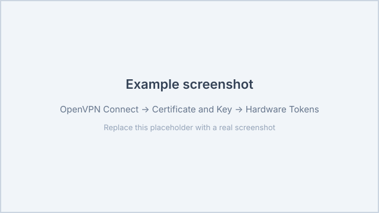

# Linking a YubiKey to OpenVPN on macOS

This guide explains how to install OpenVPN on macOS and link your YubiKey to the
OpenVPN client, so that the private key stays on the YubiKey and you are asked
for your PIV PIN when connecting (PKCS#11).

The key is generated on the YubiKey and never leaves the device. The client uses
the key through Yubico's PKCS#11 module `libykcs11.dylib`.

## 1. Requirements

- macOS (Apple Silicon or Intel).
- [Homebrew](https://brew.sh).
- A YubiKey 5 series (or another model with PKCS#11 support) and your PIV PIN.
- OpenVPN Connect 3.3 or newer (RSA certificates). ECC certificates require 3.5
  or newer.
- An OpenVPN profile (`.ovpn`) provided by your administrator.

## 2. Install the software

Install the Yubico tools, the legacy OpenVPN CLI (needed for PKCS#11) and the
YubiKey Manager CLI:

```shell
brew install openvpn yubico-piv-tool ykman
```

Install the graphical clients:

```shell
brew install --cask yubico-authenticator
brew install --cask openvpn-connect
```

> `yubico-authenticator` and `openvpn-connect` are casks (GUI apps), hence
> `--cask`. The `openvpn` formula provides the command-line binary used in the
> last section.

## 3. Put the certificate on your YubiKey

Your private key already lives on the YubiKey (created through the portal), but
you still need to write the Vault-signed certificate back to it.

1. Sign in to the YubiVault portal and generate a key + CSR (steps 1 and 2).
   Choose slot `9a` (PIV Authentication); that is the standard slot for TLS
   client authentication. Save `user.csr`.
2. Complete "Verify & Issue Certificate" in the portal and download the signed
   client certificate (for example `chris.crt`).
3. Import the certificate into the same slot on the YubiKey:

   ```shell
   ykman piv certificates import 9a chris.crt
   ```

4. Verify the result:

   ```shell
   ykman piv certificates export 9a - | openssl x509 -noout -subject -issuer
   ```

## 4. Link the PKCS#11 module

OpenVPN Connect expects the module at a fixed location: `~/.pkcs11_modules/`.
Create the directory and link the Yubico module.

Determine your Homebrew prefix and the exact module first:

```shell
brew --prefix
ls -l "$(brew --prefix)/lib/libykcs11"*.dylib
```

- Apple Silicon: `/opt/homebrew/lib/...`
- Intel: `/usr/local/lib/...`

Now create the directory and the symlink (Apple Silicon example):

```shell
mkdir -p ~/.pkcs11_modules
ln -s /opt/homebrew/lib/libykcs11.dylib ~/.pkcs11_modules/libykcs11.dylib
```

> On Intel use `/usr/local/lib/libykcs11.dylib`. If `libykcs11.dylib` is itself
> a symlink and OpenVPN cannot find the module, point at the real, versioned
> file (for example `libykcs11.2.6.0.dylib`) instead of the symlink.

## 5. Configure OpenVPN Connect

1. Quit OpenVPN Connect completely (including the menu bar icon).
2. Make sure your OpenVPN profile contains **no** embedded certificates. Remove
   the `<cert>...</cert>` and `<key>...</key>` blocks from the `.ovpn` file so
   the client can use an external certificate.
3. Start OpenVPN Connect and import the `.ovpn` profile.
4. Click the pencil (Edit) icon next to the profile.
5. Under **Certificate and Key**, choose **Assign**.
6. Choose **Hardware Tokens** and select your YubiKey.
7. Click **Authorize** and enter your PIV PIN.
8. Connect using the profile. You are asked for your PIN when the tunnel is set
   up, and the YubiKey signs the TLS handshake.

> **Certificate and Key** does not appear while editing? Then the profile still
> contains an embedded certificate or key. Remove the `<cert>`/`<key>` blocks
> and import the profile again.

Throughout the steps above you select the YubiKey as the hardware token. The
example below shows the relevant part of the dialog (the exact wording may
differ between OpenVPN Connect versions). Images are stored next to the manual
in `manuals/images/` and served from `/manual/asset/`.



## 6. Connect from the command line (optional)

The legacy `openvpn` CLI can also use the YubiKey directly over PKCS#11.

First find the PKCS#11 ID of your certificate:

```shell
openvpn --pkcs11-providers ~/.pkcs11_modules/libykcs11.dylib --show-pkcs11-ids
```

Then start the connection with the ID you found:

```shell
sudo openvpn \
  --config client.ovpn \
  --pkcs11-providers ~/.pkcs11_modules/libykcs11.dylib \
  --pkcs11-id 'Yubico/PIV_II/.../ID'
```

## Troubleshooting

- **"PKCS#11 module not found"**: check the path and architecture. Use
  `/opt/homebrew/lib/...` on Apple Silicon and `/usr/local/lib/...` on Intel.
- **The YubiKey is not detected**: check with `ykman info`, reconnect the
  YubiKey and try a different USB port.
- **No "Hardware Tokens" in OpenVPN Connect**: the profile still contains a
  `<cert>`/`<key>` block. Remove it and import the profile again.
- **ECC certificate is rejected**: update OpenVPN Connect to 3.5 or newer, or
  use an RSA certificate (for example `rsa3072`).
- **Wrong PIN / PIN blocked**: use `ykman piv access` to change the PIN or
  unblock it with the PUK/management key.
- **Certificate not visible on the card**: check with
  `ykman piv certificates export 9a -` whether you imported the certificate into
  the correct slot (the same slot as the key).
